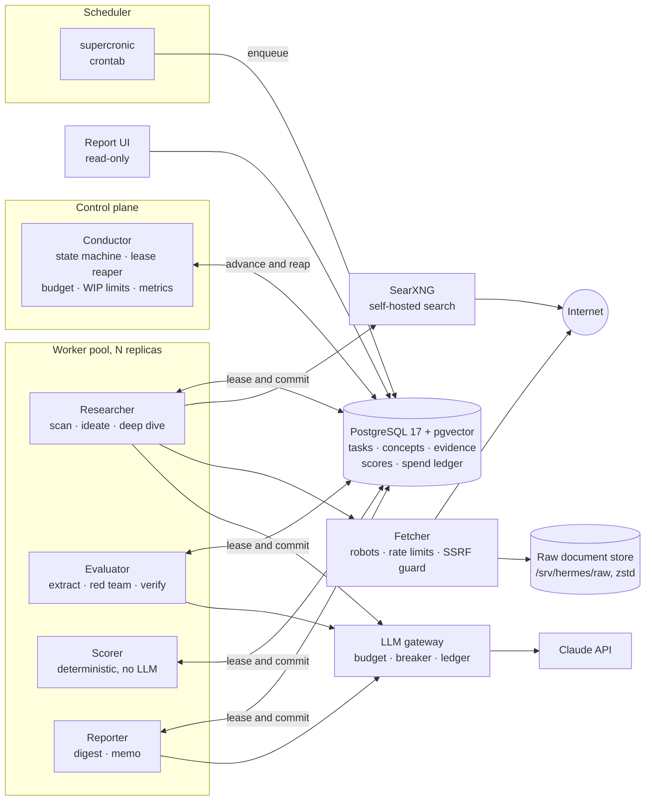
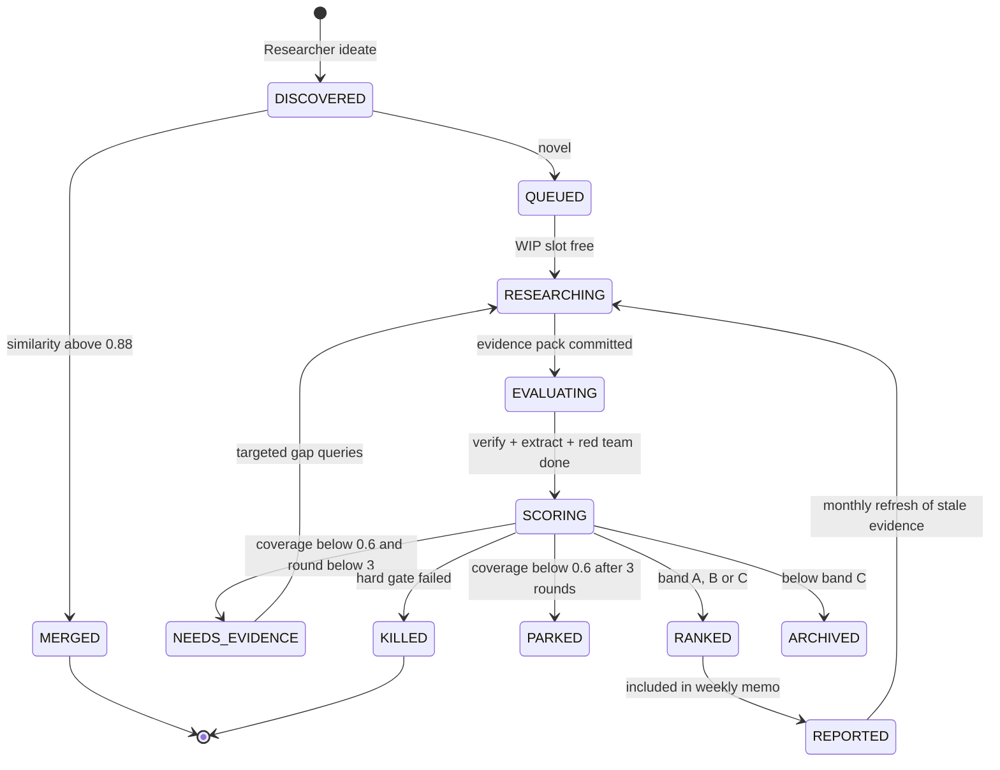
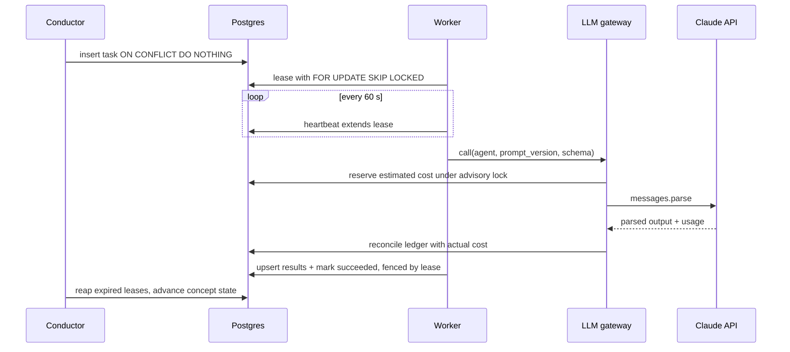
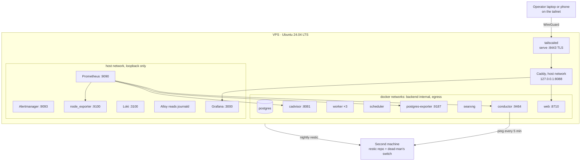

# Hermes Research Engine — System Profile

Version 1.0 · 2026-09-24 · Status: specification, not yet implemented

This document is the complete build and operations specification for the Hermes Research Engine (HRE). HRE is an autonomous system that studies fintech markets, generates startup concepts, evaluates them against a quantitative and qualitative "unicorn potential" rubric, and publishes ranked, evidence-backed reports. It runs unattended for days at a time on one self-managed VPS. A technical team should be able to build, deploy, and operate the system from this file alone. Every credential appears as a placeholder in the form `[fill-in: …]`, and every hostname or address appears in angle brackets such as `<vps-host>` or `<tailnet>`.

Naming note: this repository also documents **Hermes Agent** (the NousResearch agent, installed under `~/.hermes`, dashboard on `127.0.0.1:9119`, exposed through `tailscale serve` on port 443). HRE is a separate system that can run on the same VPS. To prevent collisions, HRE lives in `/opt/hermes-research`, stores its data in `/srv/hermes`, uses the Compose project name `hre` and the CLI name `hre`, and is served on tailnet port 8443. HRE never reads or writes anything under `~/.hermes`.

---

## 0. Brutal truths before anyone writes code

No system can reliably predict which startups become unicorns, and this one won't either. The base rate is roughly one to two percent of venture-backed seed companies. The winners depend heavily on founders, timing, and luck, and none of those appear in public web data. What HRE can do is widen the funnel, apply consistent discipline to many market hypotheses, show its evidence for every claim, and kill weak ideas early. Treat its output as a ranked list of hypotheses for human judgment. It is not a forecast, and it is not investment advice.

Numbers that a language model writes itself are untrustworthy by default. Market-size figures from press releases and "market research" pages are routinely inflated by an order of magnitude, and a model will repeat them confidently. This design therefore follows one non-negotiable rule: **no number enters a score unless it is tied to a stored source document and a verbatim quote that code has checked against that document.** Market size is always built bottom-up (number of customers × annual contract value, or volume × take rate). A single top-down "the market is $X billion" figure never counts.

Backtesting is contaminated. The model already knows which fintech companies of 2015–2020 succeeded, so a run of this rubric over historical concepts will look far better than it deserves. Section 3.7 explains how to measure calibration honestly. The short version is that you learn whether HRE works on a timescale of years, and in the meantime you use leading indicators.

The LLM is the one managed dependency in the stack, and that is deliberate. No self-hostable model that runs on a CPU-only VPS comes close to frontier models on the long, multi-document reasoning this workload needs. Self-hosting a comparable model needs GPU capacity that costs far more than the API. Everything else in the stack is open source and self-hosted.

Expect to spend real money on the model. At the default budget caps in `hermes.yaml`, API spend runs about $300–750 per month; the VPS costs a small fraction of that. Expect to spend two to four hours a week on operations and review. "Unsupervised" means the system survives days without you. It does not mean it needs nobody.

The best-scoring concepts will often turn out to be ideas that funded teams are already building. The rubric includes a crowdedness factor, and the reports list existing competitors explicitly, so that "high opportunity" is never mistaken for "open field".

---

## 1. System overview

HRE runs a continuous pipeline: scan, ideate, research, evaluate, score, report. The four agents named in the brief each own one stage. A non-LLM control loop called the **Conductor** moves work between them. Every agent is stateless and every step is a durable task row in PostgreSQL, so any process can crash at any moment and the pipeline resumes from the last committed step. The database is the system's memory. No agent keeps a long-running conversation; each task opens a fresh model context built from database state, which keeps context windows small, costs predictable, and restarts safe.



### 1.1 Components at a glance

The **Conductor** is a single long-running Python process with no LLM access. Every 30 seconds it reclaims expired task leases, advances each concept's state machine once that concept's child tasks have finished, enforces work-in-progress limits and budget caps, writes the heartbeat, and exposes Prometheus metrics derived from the database. It is the only component that creates follow-on tasks. That keeps orchestration logic in one readable file instead of scattering it across agents.

**Workers** are identical containers that lease tasks from the `tasks` table with `FOR UPDATE SKIP LOCKED`, run the handler for the task's role, and commit the results. Three replicas are the default. Each replica exits after 200 tasks and Compose restarts it, which caps the damage from slow memory leaks in parsing libraries.

The **LLM gateway** is a library that all LLM calls go through. It reserves budget before each call, enforces per-task and daily caps, applies a circuit breaker to API errors, records token usage and cost in the ledger, handles refusals by retrying once on a fallback model, and stamps every call with the agent name and prompt version.

The **Fetcher** is a library, not a service. It respects `robots.txt`, enforces a minimum interval per domain, refuses private and loopback destinations, caps response size, stores the raw body compressed on disk under its content hash, and extracts clean text with trafilatura (and pypdf for PDFs).

**SearXNG** provides self-hosted metasearch with a JSON API. Be honest about its limits: it scrapes public search engines, and from a datacenter IP it will sometimes be rate-limited or served degraded results. The Researcher treats search as one source among several, relies heavily on structured public APIs (Section 3.2), and records search failures as metrics rather than retrying forever.

The **Report UI** is a small read-only FastAPI app. It connects with a database role that can only `SELECT`, and it renders reports, concept pages, and the evidence behind every number.

### 1.2 Technology choices and why

Python 3.12 is the implementation language because the data-extraction and scientific libraries this workload needs live there. PostgreSQL does four jobs: system of record, task queue, vector store (pgvector, for de-duplication), and audit log. One database is easier to back up, reason about, and restore than a Postgres + Redis + Temporal combination, and at this scale (thousands of tasks per day, not millions) a `SKIP LOCKED` queue has ample headroom. Temporal, Airflow, and Prefect were rejected as operational overkill for one VPS and one operator. LangGraph and similar agent frameworks were rejected because the control flow here is a fixed pipeline, which a plain state machine expresses more transparently, and because those frameworks' APIs move faster than a solo operator can track. Embeddings for de-duplication come from a small local open-source model (`BAAI/bge-small-en-v1.5`, 384 dimensions, run on CPU through `fastembed`), so no second API dependency is needed.

---

## 2. Agent architecture

### 2.1 Roles and contracts

Each agent is a set of task handlers with a fixed input schema, a fixed output schema, an allowlist of tools, and a versioned prompt stored in `prompts/<agent>/<task_kind>.v<N>.md`. Prompts are loaded at startup, hashed, and recorded on every LLM call, so every output can be traced to the exact prompt that produced it. Only the Researcher can touch the network. The Evaluator and Reporter see only documents and rows already in the database. The Scorer is plain code.

**The Researcher** handles three task kinds. `scan` runs every six hours. It pulls new items from the configured sources (regulatory feeds, SEC Form D filings, complaint databases, news and research feeds, DeFi protocol metrics), stores them as `signals`, de-duplicates them with embedding similarity, and tags each with segment, geography, and signal type (regulatory change, new payment rail, cost-curve shift, incumbent failure, customer-pain spike, funding cluster). `ideate` runs once a day. It clusters the last 30 days of signals and proposes at most `max_new_concepts_per_day` concept cards. Each card names the customer, the painful job to be done, the "why now" catalyst with a dated signal ID, the wedge product, the business-model archetype, the expansion path, and the known comparable companies. Before a card is created, a novelty check compares its embedding with existing concepts. At cosine similarity of 0.88 or above, the card is merged into the existing concept as a variant. `deep_dive` runs per concept. It is a bounded tool-use loop of at most 25 tool calls and at most `per_concept_usd` in spend, working from a checklist generated from the rubric: find evidence for each required metric, each moat dimension, the competitor set, and the regulatory path. Its output is an evidence pack: document rows plus claim rows, where each claim has a verbatim quote, a document ID, an optional metric key with value, unit, and as-of date, and the model's own confidence. When the Conductor sends a concept back with `NEEDS_EVIDENCE`, the deep dive runs again, but only for the metrics listed as missing.

**The Evaluator** handles three sequential task kinds per concept, and none of them may introduce facts that aren't in the evidence pack. `verify` is mostly code. For each claim it normalizes whitespace and Unicode in both the quote and the stored document text, then runs a `rapidfuzz.fuzz.partial_ratio` match. It marks the claim `verified` at a score of 92 or higher, `weak` from 80 to 92, and `unverified` below 80. It also checks that the claimed number actually appears in the quote. Only verified claims can feed the Scorer. `extract` asks the model to fill the rubric's metric schema, using only verified claims. Every metric carries a low, point, and high estimate, the evidence IDs it rests on, and a derivation written as arithmetic, for example "4,700 US community banks × $60,000 ACV". Market size is always submitted as components (customer count, ACV, volume, take rate), and code multiplies them. A metric with no supporting evidence must be returned as null; the prompt says so, and the output schema allows it. `red_team` is a separate call with an adversarial brief: argue that this company fails. It must produce the three strongest failure modes, the regulatory blockers, incumbent responses, and dependency risks (for example a single sponsor bank). Each item carries a severity and, if it is to count as fatal, a verified evidence ID. A red-team "fatal" finding without verified evidence becomes a warning, not a kill. That stops the model from killing good ideas based on its own imagination.

**The Scorer** is deterministic Python with no model calls. It loads `rubric.yaml`, applies the hard gates, maps each metric onto a 0–1 scale, applies the weights and red-flag penalties, computes evidence coverage and confidence, and runs a 2,000-draw Monte Carlo over each metric's low, point, and high triangle. It stores the median composite, the P10 and P90, and the probability of reaching band A. Because the Scorer is code, the same inputs always produce the same score, scores can be recomputed for every concept whenever the rubric changes, and the rubric itself can be unit-tested.

**The Reporter** produces a daily digest and a weekly memo. The input is a JSON "fact sheet" assembled by code from the database. The model writes prose around those facts, and a post-check then pulls every number out of the generated text and confirms that each one matches a number in the fact sheet, allowing for formatting and rounding tolerance. If any number fails the check, the Reporter regenerates once. If it fails again, the Reporter publishes the template-only version with the prose sections left empty and raises an alert. Reports are written to `/srv/hermes/reports` as Markdown and HTML, indexed in the `reports` table, served by the Report UI, and emailed as a short summary with a link.

### 2.2 Concept lifecycle



Only the Conductor changes concept state, and every transition writes a row to `events` recording the reason, so the question "why was this killed?" always has an answer. `PARKED` concepts are not failures. Some good ideas are simply under-documented on the public web, which is exactly where interesting startups tend to sit. The weekly memo therefore lists parked concepts that carry high moat scores, so a human can research them manually.

### 2.3 Orchestration and state management

Every unit of work is a row in `tasks` with a role, a kind, a JSON payload, an idempotency key, a priority, an attempt counter, and a lease. The lifecycle of a task is `queued → leased → succeeded`, with `failed → queued` on a retryable error and `dead` once `max_attempts` is exhausted. Idempotency keys are deterministic. Examples: `scan:2026-09-24T06`, `deep_dive:<concept_id>:round2`, `report:weekly:2026-W39`. A duplicate cron fire or a Conductor restart therefore can't create duplicate work, because the insert uses `ON CONFLICT (idempotency_key) DO NOTHING`.

Leasing and fencing work like this. A worker leases a task for 10 minutes and extends the lease every 60 seconds from a heartbeat thread. When it finishes, it commits results and marks the task succeeded in one transaction, and only `WHERE id = $task AND lease_owner = $me AND attempts = $attempt_at_lease` counts. If the lease expired and another worker picked up the task, the late commit matches zero rows and is discarded. Every side-effect write is an upsert keyed on content (for example `(concept_id, document_id, claim_hash)` for evidence), so replaying a task is always safe. LLM calls are the one non-idempotent side effect, since they cost money. The lease design accepts that a crashed task's model spend happens twice, and the per-task budget caps the damage.



The core queue SQL:

```sql
-- Lease one task for this worker's roles.
UPDATE tasks t
   SET status = 'leased',
       lease_owner = %(owner)s,
       lease_expires_at = now() + make_interval(secs => %(lease_s)s),
       attempts = t.attempts + 1,
       updated_at = now()
 WHERE t.id = (
         SELECT id FROM tasks
          WHERE status = 'queued'
            AND role = ANY(%(roles)s)
            AND not_before <= now()
          ORDER BY priority DESC, created_at
          FOR UPDATE SKIP LOCKED
          LIMIT 1)
RETURNING t.*;

-- Conductor reaper: reclaim abandoned leases.
UPDATE tasks
   SET status = CASE WHEN attempts >= max_attempts THEN 'dead' ELSE 'queued' END,
       lease_owner = NULL,
       not_before = now() + interval '1 minute',
       updated_at = now()
 WHERE status = 'leased' AND lease_expires_at < now();
```

The worker loop, abbreviated. The real module adds structured logging and signal handling:

```python
# src/hre/worker.py
def run(roles: list[str], max_tasks: int) -> None:
    owner = f"{socket.gethostname()}:{os.getpid()}"
    done = 0
    while done < max_tasks and not STOP.is_set():
        if system_mode() in ("paused", "draining"):
            STOP.wait(30); continue
        task = lease(owner, roles, lease_s=CFG.leases.default_seconds)
        if task is None:
            STOP.wait(5); continue
        hb = Heartbeat(task.id, owner, every=CFG.leases.heartbeat_seconds).start()
        try:
            result = HANDLERS[(task.role, task.kind)](task)      # no open DB txn while this runs
            with db.transaction() as tx:
                result.persist(tx)                               # upserts only
                ok = tx.execute(MARK_SUCCEEDED, dict(id=task.id, owner=owner,
                                                    attempt=task.attempts)).rowcount
                if ok == 0:
                    tx.rollback()                                # lease was lost; discard
        except PermanentError as e:
            mark_dead(task, owner, repr(e))
        except Exception as e:                                   # retryable by default
            backoff = min(CFG.retries.backoff_max_seconds,
                          CFG.retries.backoff_base_seconds * 2 ** (task.attempts - 1))
            requeue(task, owner, delay=backoff * random.uniform(0.8, 1.2), error=repr(e))
        finally:
            hb.stop()
            done += 1
    sys.exit(0)   # Compose restarts the container: bounded memory growth
```

The Conductor checks `system_state.mode` on every tick. `running` is normal. `throttled` is set automatically when daily spend passes 90 percent of the cap; the Conductor then stops creating new deep dives but lets in-flight work finish. `paused` is set by the operator or by a critical alert handler; workers stop leasing. `draining` is set before upgrades; workers finish their current task and then idle. Work-in-progress limits (at most four concepts researching and four evaluating by default) give backpressure, so a burst of ideation can't turn into an unbounded bill.

### 2.4 The LLM gateway

All model access goes through `hre.llm.call()`. The default model for every agent is `claude-opus-5` with adaptive thinking (on by default for this model). `effort` is set per agent in `hermes.yaml`. The decision to move bulk extraction to a cheaper model such as `claude-sonnet-5` or `claude-haiku-4-5` is deliberately left to the operator: make it only after measuring quality on the golden evaluation set (Section 3.8), never on a hunch. Work that isn't latency-sensitive (the weekly rescoring extraction and backfill evaluation) goes through the Message Batches API, which runs asynchronously at half the price. System prompts and the rubric are placed first in every request and kept byte-stable, so prompt caching takes effect. Check `usage.cache_read_input_tokens` on the dashboard. If it stays at zero, something (usually a timestamp) is invalidating the prefix.

```python
# src/hre/llm.py  (abbreviated; verify SDK call shapes against current Anthropic docs at build time)
import anthropic
from pydantic import BaseModel

client = anthropic.Anthropic()          # reads ANTHROPIC_API_KEY from the environment

def call(agent: str, task_id: int, system: str, messages: list, schema: type[BaseModel],
         est_input_tokens: int) -> BaseModel:
    spec = CFG.llm.agents[agent]
    if BREAKER.is_open():
        raise RetryableError("llm circuit open")
    # raises BudgetExceeded (permanent for this task) if any cap would be breached
    reservation = budget.reserve(task_id, agent, spec.model, est_input_tokens, spec.max_tokens)
    try:
        resp = client.messages.parse(
            model=spec.model, max_tokens=spec.max_tokens,
            system=system, messages=messages, output_format=schema,
        )
        if resp.stop_reason == "refusal" and CFG.llm.refusal_fallback_model:
            ledger.record(reservation, resp)                     # a refusal before output is not billed
            resp = client.messages.parse(
                model=CFG.llm.refusal_fallback_model, max_tokens=spec.max_tokens,
                system=system, messages=messages, output_format=schema,
            )
        if resp.stop_reason == "refusal":
            raise PermanentError("refused by primary and fallback model")
        if resp.stop_reason == "max_tokens":
            raise RetryableError("truncated output; raise max_tokens for this agent")
        BREAKER.success()
        ledger.record(reservation, resp)                          # tokens, cache tokens, cost, stop_reason
        return resp.parsed_output
    except (anthropic.RateLimitError, anthropic.InternalServerError, anthropic.APIConnectionError):
        BREAKER.failure(); budget.release(reservation); raise RetryableError("llm transient")
    except anthropic.BadRequestError as e:
        budget.release(reservation); raise PermanentError(f"llm 400: {e}")
```

Budget reservation takes a transaction-scoped Postgres advisory lock (`pg_advisory_xact_lock(4242)`). It sums today's committed plus reserved spend, rejects the call if the estimate would exceed the daily, monthly, or per-concept cap, and inserts a reservation row. Reconciliation replaces the estimate with the actual cost, calculated from `usage` and the pricing table in `hermes.yaml`. Keep that table current, because prices change. As an outer backstop that works even if this code has a bug, set a monthly spend limit on the API key's workspace in the Anthropic Console.

The circuit breaker opens after five consecutive transient failures and stays open for 15 minutes, doubling up to two hours on repeated trips. While it is open, workers requeue LLM tasks without calling the API. That way a multi-hour provider outage costs nothing and self-heals.

### 2.5 Untrusted content and prompt-injection defence

Every fetched page is hostile input. Documents go into prompts only inside delimited blocks (`<document id="…" source="…" trust="untrusted">…</document>`), and each system prompt states that document content is data and never instructions. The Researcher's only tools are `search`, `fetch`, and the structured-source readers, all read-only. No agent has a shell, write access to the filesystem, the ability to send email, or any credential in its context. The worst a successful injection can do is waste a task's budget or plant a false claim. False claims then have to survive quote verification against the stored source, the red-team pass, and the Reporter's number check. The golden evaluation set includes injected pages to prove this.

The Fetcher also guards against server-side request forgery, because the Researcher chooses URLs. Before connecting, and again after every redirect, the Fetcher resolves the host and refuses any address that is loopback, private, link-local, multicast, reserved, or in the RFC 6598 shared space that Tailscale uses:

```python
# src/hre/fetch/guard.py
import ipaddress, socket
SHARED_SPACE = ipaddress.IPv4Network((0x64400000, 10))   # RFC 6598 shared address space (Tailscale)

def assert_public(host: str) -> None:
    for info in socket.getaddrinfo(host, None):
        ip = ipaddress.ip_address(info[4][0])
        if (ip.is_private or ip.is_loopback or ip.is_link_local or ip.is_multicast
                or ip.is_reserved or ip.is_unspecified
                or (ip.version == 4 and ip in SHARED_SPACE)):
            raise PermanentError(f"refusing non-public destination for {host}")
```

A resolve-then-connect guard leaves a small DNS-rebinding window. That residual risk is accepted because nothing valuable listens where a container could reach it. Monitoring services bind only to the host's loopback, which containers cannot reach, and Postgres requires a password.

---

## 3. Unicorn research methodology

### 3.1 The unicorn arithmetic the rubric is built on

A $1B valuation for a fintech company generally requires around $100M in annual revenue at roughly a 10× revenue multiple. The multiple varies widely by model and by market cycle. Infrastructure and software fetch more; lenders and payment companies with thin margins fetch much less. The rubric makes this assumption explicit and configurable (`valuation_assumption` in `rubric.yaml`) and derives most of its thresholds from it. The core question for every concept becomes: *is there a plausible, evidence-backed path to about $100M of high-quality revenue within about eight years, with some defence against competitors copying it?* That turns into three questions a machine can check: is the reachable revenue pool big enough that $100M is a small share of it; do the unit economics at scale support a venture-scale valuation; and does anything stop a well-funded competitor or an incumbent from taking it away?

### 3.2 Evidence sources

Search results alone make a weak foundation, so the Researcher is built around structured, attributable public sources first. Signals that a market is moving come from the SEC EDGAR full-text search and submissions APIs, especially Form D filings for private fundraises in financial-services industry codes (a free, near-real-time funding feed) and S-1 and 10-K filings, which contain audited unit economics for public fintech comparables. Further signal sources are the Federal Register API and regulator press feeds (CFPB, OCC, FDIC, Federal Reserve, FinCEN, SEC, and in Europe the EBA, ESMA, and FCA), the CFPB consumer-complaint database (complaint spikes by product are a direct measure of customer pain), FRED and BIS statistics for market growth rates, the FDIC BankFind and NCUA datasets for counting bank and credit-union customers bottom-up, UK Companies House for European formation activity, DefiLlama for protocol fees and revenue in on-chain markets, arXiv `q-fin` and SSRN for emerging techniques, GitHub for open-source adoption of financial infrastructure, and a curated RSS list of fintech trade press. Commercial funding databases (Crunchbase, PitchBook, Dealroom) are optional connectors marked `[fill-in: licence]`. Without one, competitor funding data will have gaps, and this is the biggest known data-quality gap in the design. Form D filings and news coverage fill part of it.

The SEC requires a descriptive User-Agent that includes contact details and enforces a fair-access rate of ten requests per second; the source config sets both. Every source entry records its terms-of-use status. The Fetcher never logs in anywhere, never scrapes sites whose terms forbid automated access (LinkedIn is explicitly blocklisted), and honours `robots.txt`.

### 3.3 Quantitative criteria

Every quantitative metric is estimated as a low, point, and high triangle from verified evidence, and every market-size metric is built from components that code multiplies.

Market size is measured twice. The **TAM revenue pool** is the total annual revenue available to every company solving this problem worldwide. The **SAM revenue pool** is the share that this concept's wedge can reach in its first two geographies with its first product. Both are revenue, not transaction volume: a $2 trillion payments flow at a 0.3 percent net take rate is a $6B revenue pool, and this rubric only uses the second number. TAM must be at least $2B and SAM at least $300M, or the concept is killed. SAM is scored on a log scale from zero at $250M to full marks at $5B.

**Required penetration** is the unicorn revenue target divided by SAM. It answers "what share of the reachable market would we need?" At 3 percent or less it earns full marks; the score falls linearly to zero at 25 percent; above 40 percent the concept is killed. This metric pushes back against the most common founder error, which is a real but too-small market.

**Market growth** is the compound annual growth rate of the underlying revenue pool, or of its best measurable proxy (volumes, user counts, account openings), over the most recent three to five years, and it must come from a dated source. A CAGR below 8 percent is a kill unless a dated catalyst (regulatory or technological) is expected to break the trend; in that case the `why_now` score has to carry the concept. The score runs linearly from zero at 5 percent to full marks at 30 percent.

**Unit margin at scale** is scored against the concept's business-model archetype, because a single gross-margin threshold would be wrong for fintech. Software and infrastructure are measured on gross margin, with a floor of 65 percent and a target of 75. Payments are measured on gross margin over net revenue, after interchange and network costs, with a floor of 40 and a target of 60. Lending is measured on risk-adjusted net interest margin (yield minus cost of funds minus expected credit losses), with a floor of 4 and a target of 8. Marketplaces and brokerages are measured on contribution margin, with a floor of 40 and a target of 60. Crypto protocols are measured on incentive-adjusted margin (fees retained by the protocol minus token emissions paid out, as a share of fees), with a floor of 0 and a target of 40, which means emissions-subsidised "revenue" counts for nothing. Below the floor is a kill. Between floor and target the score scales linearly.

**Capital to first licensed revenue** estimates the money needed before the company can legally earn its first dollar, including licences, sponsor-bank setup, compliance staff, and regulatory capital. It runs from full marks at $2M or less to zero at $30M. **Competitive density** counts well-funded direct competitors, meaning companies with a disclosed raise above $20M addressing the same customer with the same wedge. The scale is deliberately non-monotonic: zero competitors scores 0.6, because that often means no market; one to five scores full marks, because a validated market isn't yet dominated; twelve or more scores zero.

### 3.4 Qualitative moats

Moats are scored from 0 to 5 against written anchors, and the Evaluator must cite evidence for any score above 2. The anchors live in `rubric.yaml` so they can be versioned and reviewed like code.

The **regulatory moat** measures how hard the licence is to obtain for someone who hasn't done it yet. It runs from 0 (no licence needed) through 3 (multi-jurisdiction licensing of 12–24 months costing seven figures, such as US state money-transmitter licences in every state or an EU EMI licence passported across the bloc) to 5 (a scarce charter or designation, such as a bank charter with direct payment-system access). The regulatory moat cuts both ways. A barrier that protects the company once it has its licence can also kill it before then, which is why capital to first licensed revenue is a separate metric and regulatory existential risk is a separate penalty.

**Network effects** run from 0 (none) through 3 (cross-side effects demonstrated in one geography, meaning more participants on one side measurably improve the product for the other) to 5 (protocol- or standard-level effects of the kind card networks enjoy). The rubric treats "data network effects" with scepticism. Claims of them max out at 2 unless there is evidence that more data measurably improves outcomes, such as lower loss rates or higher approval rates at the same risk.

**Switching costs and embeddedness** run from 0 (a stateless tool a customer can drop in an afternoon) to 5 (the system of record, with integration, compliance re-certification, and data migration costs of the kind core banking and payroll carry). **Proprietary data** runs from 0 (only public data) to 5 (exclusive, compounding data rights that competitors cannot license). **Distribution advantage** runs from 0 (paid acquisition only) to 5 (embedded in a channel the customer already uses, with contractual exclusivity, or structurally negative acquisition cost). **Scale economies** run from 0 to 5 according to how much unit cost falls with volume (fraud models, funding costs, fixed compliance cost spread over more customers).

The **why now** score (0–5) rewards a dated catalyst from the last 36 months that makes the concept newly possible or newly necessary. Examples: a final rule, a new payment rail reaching coverage, a stablecoin or market-structure law, a cost curve crossing a threshold, or an incumbent failure. Legislative and regulatory status changes quickly (US open-banking data-access rules, for example, have been rewritten and challenged repeatedly), so the Researcher must re-verify the current status of any regulatory catalyst on every refresh and must not rely on the model's background knowledge.

### 3.5 Red flags and hard gates

Red flags subtract points: dependence on a single partner with no substitute, such as one sponsor bank (the 2024 Synapse collapse, which froze end-customer funds, is the reference case) −5; regulatory existential risk, where the model only works if a pending rule goes one way, −10; incumbent bundling risk, where a dominant platform can ship this as a free feature, −5; balance-sheet credit risk with no identified funding source −5. Hard gates kill a concept outright. They are: the TAM or SAM floors; margin below the archetype floor; required penetration above 40 percent; the activity being prohibited in both target geographies; and a red-team fatal finding backed by verified evidence.

### 3.6 Composite, bands and confidence

The weights total 100: SAM 15, TAM 5, market growth 10, unit margin 15, required penetration 10, capital to first revenue 5, competitive density 5, why-now 10, and moats 25 (regulatory 5, network effects 5, switching costs 5, proprietary data 4, distribution 4, scale economies 2). A missing metric scores zero rather than being dropped from the denominator. This is deliberate: a concept can't score well by being vague. The `NEEDS_EVIDENCE` loop exists so that missing evidence gets researched rather than punished forever.

Confidence runs from 0 to 1. It is the weight-averaged product of evidence coverage (did the metric get a verified estimate), verification strength (verified 1.0, weak 0.5), and freshness (1.0 up to 12 months, falling linearly to 0.3 at 36 months). **Band A** needs a median composite of at least 75 and confidence of at least 0.6. **Band B** needs 60, **band C** 45, and anything below is archived. The weekly memo leads with band A and B concepts ranked by the probability of band A from the Monte Carlo, not by the point score, so an uncertain 78 ranks below a well-evidenced 74.

```yaml
# config/rubric.yaml
rubric_version: "2026.09-1"
valuation_assumption:
  target_valuation_usd: 1000000000
  revenue_multiple: 10            # revisit quarterly against current fintech private-market comps
  horizon_years: 8                # implied revenue target = valuation / multiple

archetypes:
  software_infra:        { metric: gross_margin,             floor: 0.65, target: 0.75 }
  payments:              { metric: net_revenue_gross_margin, floor: 0.40, target: 0.60 }
  lending:               { metric: risk_adjusted_nim,        floor: 0.04, target: 0.08 }
  marketplace_brokerage: { metric: contribution_margin,      floor: 0.40, target: 0.60 }
  crypto_protocol:       { metric: incentive_adjusted_margin, floor: 0.00, target: 0.40 }

quantitative:
  sam_revenue_pool_usd:
    weight: 15
    gate: { min: 300000000 }
    scale: { type: log, zero_at: 250000000, full_at: 5000000000 }
    components: [reachable_customers, acv_usd]          # or [annual_volume_usd, net_take_rate]
  tam_revenue_pool_usd:
    weight: 5
    gate: { min: 2000000000 }
    scale: { type: log, zero_at: 1000000000, full_at: 50000000000 }
    components: [total_customers, acv_usd]
  required_penetration:            # derived: implied revenue target / SAM
    weight: 10
    gate: { max: 0.40 }
    scale: { type: inverse_linear, full_at: 0.03, zero_at: 0.25 }
  market_cagr:
    weight: 10
    gate: { min: 0.08, unless: why_now_at_least_4 }
    scale: { type: linear, zero_at: 0.05, full_at: 0.30 }
  unit_margin_at_scale:
    weight: 15
    gate: { min: archetype.floor }
    scale: { type: linear, zero_at: archetype.floor, full_at: archetype.target }
  capital_to_first_revenue_usd:
    weight: 5
    scale: { type: inverse_linear, full_at: 2000000, zero_at: 30000000 }
  funded_direct_competitors:
    weight: 5
    scale: { type: piecewise, points: [[0, 0.6], [1, 1.0], [5, 1.0], [12, 0.0]] }

qualitative:                        # 0-5 anchored; evidence required above 2
  why_now:           { weight: 10 }
  regulatory_moat:   { weight: 5 }
  network_effects:   { weight: 5, cap_without_outcome_evidence: 2 }
  switching_costs:   { weight: 5 }
  proprietary_data:  { weight: 4 }
  distribution:      { weight: 4 }
  scale_economies:   { weight: 2 }

red_flags:
  single_partner_dependency: -5
  regulatory_existential_risk: -10
  incumbent_bundling_risk: -5
  unfunded_balance_sheet_risk: -5

hard_kills: [prohibited_in_target_geographies, verified_fatal_red_team]

bands:
  A: { min_composite: 75, min_confidence: 0.6 }
  B: { min_composite: 60 }
  C: { min_composite: 45 }

confidence:
  verification_weight: { verified: 1.0, weak: 0.5, unverified: 0.0 }
  freshness: { full_until_months: 12, floor: 0.3, floor_at_months: 36 }

monte_carlo: { draws: 2000, seed_from: concept_id }

anchors:
  regulatory_moat:
    0: "No licence or registration required."
    1: "Light registration obtainable in under 3 months."
    2: "Single-jurisdiction licence, 6-12 months, low six figures."
    3: "Multi-jurisdiction licensing, 12-24 months, seven figures (e.g. US state MTLs, EU EMI)."
    4: "Charter-level licence with regulatory capital requirements."
    5: "Scarce charter or designation with direct payment-system access."
  network_effects:
    0: "None."
    1: "Claimed only; no mechanism described."
    2: "Same-side or data effect with a plausible mechanism, unproven."
    3: "Cross-side effect evidenced in one geography."
    4: "Multi-sided effect evidenced at a comparable company at scale."
    5: "Protocol or standard-level network effect."
  # switching_costs, proprietary_data, distribution, scale_economies, why_now follow the same pattern
```

The Scorer core:

```python
# src/hre/scorer.py (core)
def scale(v: float | None, s: dict) -> float:
    if v is None:
        return 0.0
    t = s["type"]
    if t == "log":
        lo, hi = math.log10(s["zero_at"]), math.log10(s["full_at"])
        x = (math.log10(max(v, 1.0)) - lo) / (hi - lo)
    elif t == "linear":
        x = (v - s["zero_at"]) / (s["full_at"] - s["zero_at"])
    elif t == "inverse_linear":
        x = (s["zero_at"] - v) / (s["zero_at"] - s["full_at"])
    elif t == "piecewise":
        pts = s["points"]
        if v <= pts[0][0]: return pts[0][1]
        if v >= pts[-1][0]: return pts[-1][1]
        for (x0, y0), (x1, y1) in zip(pts, pts[1:]):
            if x0 <= v <= x1:
                return y0 + (y1 - y0) * (v - x0) / (x1 - x0)
    elif t == "anchored":
        x = v / 5.0
    return min(1.0, max(0.0, x))

def composite(draw: dict[str, float | None], rubric: Rubric, flags: set[str]) -> float:
    total = sum(m.weight * scale(draw.get(k), m.scale_for(draw)) for k, m in rubric.metrics.items())
    return max(0.0, total + sum(rubric.red_flags[f] for f in flags))

def score(concept: ConceptMetrics, rubric: Rubric) -> Score:
    if (kill := rubric.first_failed_gate(concept.point_values())):
        return Score.killed(kill)
    rng = random.Random(concept.id)
    draws = [composite(concept.sample(rng), rubric, concept.red_flags)
             for _ in range(rubric.monte_carlo.draws)]
    draws.sort()
    med = draws[len(draws) // 2]
    conf = rubric.confidence(concept)
    p_a = sum(d >= rubric.bands["A"].min_composite for d in draws) / len(draws)
    return Score(median=med, p10=draws[len(draws) // 10], p90=draws[9 * len(draws) // 10],
                 confidence=conf, p_band_a=p_a if conf >= rubric.bands["A"].min_confidence else 0.0,
                 band=rubric.band(med, conf), rubric_version=rubric.version)
```

The Scorer ships with unit tests that pin known inputs to known outputs, including the gate edge cases, the missing-metric behaviour, and the piecewise competitor curve. Any change to `rubric.yaml` bumps `rubric_version`, and the Conductor queues a rescore of every ranked concept so that reports never mix rubric versions.

### 3.7 Calibration without fooling yourself

Three mechanisms keep the rubric honest over time. First, a **forecast ledger**: each week the band of every ranked concept is frozen into `forecasts` together with the real companies HRE matched to that concept space. Those companies are tracked through Form D filings and news for leading indicators such as a follow-on raise within 24 months, a new licence, or a partnership. Those are observable in months, while unicorn outcomes take years. Second, a **point-in-time backtest** on a hand-built set of 30 historical concepts. Each gets an evidence pack made only from documents dated before a cut-off, with company names removed. Treat the results as a smoke test for obviously broken weights, never as proof of predictive power, because the model's background knowledge leaks through. Third, **quarterly human review**: the operator re-scores ten randomly chosen concepts by hand with the same anchors. If the operator and the system disagree by more than one band on more than three of the ten, it is time to examine prompts and anchors before trusting another memo.

### 3.8 Golden evaluation set

`evals/golden/` holds 25 concept cards with hand-labelled metrics and evidence, plus ten traps. The traps are an inflated TAM press release, a page with an embedded prompt injection, a quote that doesn't contain the claimed number, a stale 2019 statistic presented as current, a crypto protocol whose revenue is mostly emissions, and similar cases. `hre eval run` executes the Evaluator and Scorer against the set and must pass fixed thresholds before any prompt, model, or rubric change is deployed: metric extraction within tolerance on at least 80 percent of labelled metrics, zero unverified numbers reaching a score, all ten traps caught, and Scorer outputs byte-identical to the stored expectations. It costs a few dollars per run, which is cheap insurance against silently degrading an unattended system.

---

## 4. Data model

```sql
-- migrations/001_init.sql
CREATE EXTENSION IF NOT EXISTS vector;

CREATE TABLE system_state (key text PRIMARY KEY, value jsonb NOT NULL, updated_at timestamptz NOT NULL DEFAULT now());
INSERT INTO system_state VALUES ('mode', '"running"', now());

CREATE TABLE runs (
  id bigserial PRIMARY KEY, kind text NOT NULL, period text NOT NULL,
  status text NOT NULL DEFAULT 'open', git_sha text, config_hash text,
  started_at timestamptz NOT NULL DEFAULT now(), finished_at timestamptz,
  UNIQUE (kind, period));

CREATE TABLE concepts (
  id bigserial PRIMARY KEY, slug text UNIQUE NOT NULL, title text NOT NULL,
  thesis text NOT NULL, customer text NOT NULL, wedge text NOT NULL,
  archetype text NOT NULL CHECK (archetype IN ('software_infra','payments','lending','marketplace_brokerage','crypto_protocol')),
  geographies text[] NOT NULL, why_now_signal_ids bigint[] NOT NULL DEFAULT '{}',
  state text NOT NULL DEFAULT 'DISCOVERED', research_round int NOT NULL DEFAULT 0,
  merged_into bigint REFERENCES concepts(id), kill_reason text,
  embedding vector(384), created_at timestamptz NOT NULL DEFAULT now(), updated_at timestamptz NOT NULL DEFAULT now());
CREATE INDEX ON concepts USING hnsw (embedding vector_cosine_ops);
CREATE INDEX ON concepts (state);

CREATE TABLE tasks (
  id bigserial PRIMARY KEY, run_id bigint REFERENCES runs(id), concept_id bigint REFERENCES concepts(id),
  role text NOT NULL, kind text NOT NULL, payload jsonb NOT NULL DEFAULT '{}',
  idempotency_key text UNIQUE NOT NULL, priority int NOT NULL DEFAULT 0,
  status text NOT NULL DEFAULT 'queued' CHECK (status IN ('queued','leased','succeeded','dead')),
  attempts int NOT NULL DEFAULT 0, max_attempts int NOT NULL DEFAULT 4,
  lease_owner text, lease_expires_at timestamptz, not_before timestamptz NOT NULL DEFAULT now(),
  last_error text, result jsonb,
  created_at timestamptz NOT NULL DEFAULT now(), updated_at timestamptz NOT NULL DEFAULT now());
CREATE INDEX tasks_ready ON tasks (role, priority DESC, created_at) WHERE status = 'queued';
CREATE INDEX tasks_leased ON tasks (lease_expires_at) WHERE status = 'leased';

CREATE TABLE signals (
  id bigserial PRIMARY KEY, source text NOT NULL, url text NOT NULL, title text,
  published_at timestamptz, retrieved_at timestamptz NOT NULL DEFAULT now(),
  signal_type text, segment text, geography text, summary text,
  content_hash text NOT NULL, embedding vector(384), UNIQUE (source, content_hash));
CREATE INDEX ON signals USING hnsw (embedding vector_cosine_ops);

CREATE TABLE documents (
  id bigserial PRIMARY KEY, url text NOT NULL, domain text NOT NULL,
  fetched_at timestamptz NOT NULL DEFAULT now(), http_status int, content_type text,
  content_hash text UNIQUE NOT NULL, raw_path text NOT NULL, text_path text NOT NULL,
  published_at timestamptz, title text);

CREATE TABLE evidence (
  id bigserial PRIMARY KEY, concept_id bigint NOT NULL REFERENCES concepts(id),
  document_id bigint NOT NULL REFERENCES documents(id), claim text NOT NULL, quote text NOT NULL,
  claim_hash text NOT NULL, metric_key text, value numeric, unit text, as_of date,
  verification text NOT NULL DEFAULT 'pending' CHECK (verification IN ('pending','verified','weak','unverified')),
  match_score int, prompt_version text NOT NULL, created_at timestamptz NOT NULL DEFAULT now(),
  UNIQUE (concept_id, document_id, claim_hash));

CREATE TABLE evaluations (
  id bigserial PRIMARY KEY, concept_id bigint NOT NULL REFERENCES concepts(id), round int NOT NULL,
  metrics jsonb NOT NULL, moats jsonb NOT NULL, red_team jsonb NOT NULL, red_flags text[] NOT NULL DEFAULT '{}',
  prompt_versions jsonb NOT NULL, created_at timestamptz NOT NULL DEFAULT now(), UNIQUE (concept_id, round));

CREATE TABLE scores (
  id bigserial PRIMARY KEY, concept_id bigint NOT NULL REFERENCES concepts(id),
  evaluation_id bigint NOT NULL REFERENCES evaluations(id), rubric_version text NOT NULL,
  killed_by text, median numeric, p10 numeric, p90 numeric, confidence numeric, p_band_a numeric, band text,
  created_at timestamptz NOT NULL DEFAULT now(), UNIQUE (evaluation_id, rubric_version));

CREATE TABLE forecasts (
  id bigserial PRIMARY KEY, concept_id bigint NOT NULL REFERENCES concepts(id), week text NOT NULL,
  band text NOT NULL, p_band_a numeric, matched_companies jsonb NOT NULL DEFAULT '[]', UNIQUE (concept_id, week));

CREATE TABLE llm_calls (
  id bigserial PRIMARY KEY, task_id bigint REFERENCES tasks(id), agent text NOT NULL, model text NOT NULL,
  prompt_version text NOT NULL, status text NOT NULL DEFAULT 'reserved',
  est_cost_usd numeric NOT NULL, cost_usd numeric, input_tokens int, output_tokens int,
  cache_read_tokens int, cache_write_tokens int, stop_reason text, latency_ms int, batch boolean NOT NULL DEFAULT false,
  created_at timestamptz NOT NULL DEFAULT now());
CREATE INDEX ON llm_calls (created_at);

CREATE TABLE reports (
  id bigserial PRIMARY KEY, kind text NOT NULL, period text NOT NULL, md_path text NOT NULL,
  html_path text NOT NULL, number_check text NOT NULL, created_at timestamptz NOT NULL DEFAULT now(), UNIQUE (kind, period));

CREATE TABLE events (
  id bigserial PRIMARY KEY, at timestamptz NOT NULL DEFAULT now(), actor text NOT NULL,
  entity text NOT NULL, entity_id bigint, action text NOT NULL, detail jsonb NOT NULL DEFAULT '{}');

-- Least-privilege roles (passwords set at deploy time, never in migrations).
CREATE ROLE hre_reader NOLOGIN;
GRANT SELECT ON ALL TABLES IN SCHEMA public TO hre_reader;
ALTER DEFAULT PRIVILEGES IN SCHEMA public GRANT SELECT ON TABLES TO hre_reader;
```

Raw documents live outside the database, at `/srv/hermes/raw/<first two hex chars of hash>/<hash>.zst`, next to the extracted text. They are kept for 365 days and then deleted unless evidence still references them. Evidence-backed documents are kept indefinitely, because web pages change and the stored copy is the audit trail.

---

## 5. VPS deployment stack

### 5.1 Host sizing and layout

The minimum host is 4 vCPU, 8 GB RAM, and 160 GB NVMe running Ubuntu Server 24.04 LTS. Use 16 GB RAM if Hermes Agent and its cockpit also run on the same machine. Any mainstream VPS provider works. The monitoring stack uses about 1.5 GB of RAM, which is the cost of trusting a multi-day unattended run. On a tighter budget, Loki and Alloy are the first things to drop, because `journalctl` still works. A second, much smaller machine is required for offsite backups and the dead-man's switch (Section 5.9). Monitoring that runs on the same box as the thing it monitors cannot tell you that the box has died.



Nothing listens on a public interface. The only inbound path is the tailnet. `tailscale serve` terminates TLS with the machine's MagicDNS certificate on port 8443 and proxies to Caddy on loopback, and Caddy routes to the Report UI and Grafana. Port 443 is left free for the Hermes Agent cockpit, which already uses it. Every host-network service binds to `127.0.0.1`, so containers can't reach them either. Published container ports bind to `127.0.0.1` only. This matters because Docker writes its own iptables rules, and a port published on all interfaces bypasses UFW entirely.

| Path | Purpose |
|---|---|
| `/opt/hermes-research` | Git checkout: `compose.yaml`, `config/`, `prompts/`, `deploy/`, `.env` (mode 600) |
| `/opt/hermes-research/secrets/` | Secret files mounted into Alertmanager (mode 700) |
| `/srv/hermes/raw` | Compressed raw documents and extracted text (uid 10001) |
| `/srv/hermes/reports` | Generated reports (uid 10001) |
| `/srv/hermes/backups` | Local pg_dump staging, three days |
| `/srv/hermes/textfile` | node_exporter textfile metrics (backup timestamp) |

### 5.2 Step 1: base OS and operator account

Run as root on first login, using the provider's console or an SSH key you uploaded:

```bash
apt-get update && apt-get -y full-upgrade
apt-get install -y ufw fail2ban unattended-upgrades apt-listchanges chrony jq restic \
                   curl ca-certificates gnupg zstd
timedatectl set-timezone UTC

adduser --disabled-password --gecos "" ops
passwd ops                                   # store in your password manager; needed for sudo
usermod -aG sudo ops
install -d -m 700 -o ops -g ops /home/ops/.ssh
install -m 600 -o ops -g ops /root/.ssh/authorized_keys /home/ops/.ssh/authorized_keys

fallocate -l 4G /swapfile && chmod 600 /swapfile && mkswap /swapfile && swapon /swapfile
echo '/swapfile none swap sw 0 0' >> /etc/fstab
```

```bash
cat > /etc/ssh/sshd_config.d/10-hermes.conf <<'EOF'
PermitRootLogin no
PasswordAuthentication no
KbdInteractiveAuthentication no
PubkeyAuthentication yes
AllowUsers ops
X11Forwarding no
AllowAgentForwarding no
MaxAuthTries 3
LoginGraceTime 30
EOF
sshd -t && systemctl restart ssh

cat > /etc/sysctl.d/99-hermes.conf <<'EOF'
vm.swappiness = 10
kernel.dmesg_restrict = 1
kernel.kptr_restrict = 2
net.ipv4.tcp_syncookies = 1
net.ipv4.conf.all.accept_redirects = 0
net.ipv4.conf.all.send_redirects = 0
net.ipv6.conf.all.accept_redirects = 0
EOF
sysctl --system

cat > /etc/apt/apt.conf.d/52hermes-unattended <<'EOF'
Unattended-Upgrade::Automatic-Reboot "true";
Unattended-Upgrade::Automatic-Reboot-Time "04:30";
Unattended-Upgrade::Remove-Unused-Dependencies "true";
EOF
dpkg-reconfigure -f noninteractive -plow unattended-upgrades

mkdir -p /etc/systemd/journald.conf.d
printf '[Journal]\nSystemMaxUse=2G\nMaxRetentionSec=30day\n' > /etc/systemd/journald.conf.d/hermes.conf
systemctl restart systemd-journald
```

Before closing the root session, open a second terminal and confirm that `ssh ops@<VPS_PUBLIC_ADDRESS>` works. The nightly reboot window at 04:30 UTC is safe by design: leases expire, tasks are requeued, and the Compose stack comes back through systemd. Docker packages come from Docker's own repository, which unattended-upgrades doesn't cover, so Docker upgrades are a deliberate monthly step (Section 6.3).

### 5.3 Step 2: Tailscale and firewall

```bash
curl -fsSL https://tailscale.com/install.sh | sh
sudo tailscale up                         # open the printed URL and authorise the machine
tailscale status                          # note the MagicDNS name <vps-host>.<tailnet>.ts.net
```

In the Tailscale admin console, enable MagicDNS and HTTPS certificates. Add an ACL that lets only your own devices reach this machine on ports 22 and 8443. The ACL is a second layer of protection; it doesn't replace the host firewall.

```bash
sudo ufw default deny incoming
sudo ufw default allow outgoing
sudo ufw allow OpenSSH                                        # TEMPORARY: removed below
sudo ufw allow in on tailscale0 to any port 22,8443 proto tcp
sudo ufw allow 41641/udp                                      # optional: direct WireGuard paths
sudo ufw enable

# From your laptop, over the tailnet, confirm: ssh ops@<vps-host>.<tailnet>.ts.net
# Only then close public SSH. The provider's web console is the break-glass path.
sudo ufw delete allow OpenSSH
sudo ufw status verbose

sudo systemctl enable --now fail2ban
```

### 5.4 Step 3: Docker Engine

```bash
sudo install -m 0755 -d /etc/apt/keyrings
sudo curl -fsSL https://download.docker.com/linux/ubuntu/gpg -o /etc/apt/keyrings/docker.asc
sudo chmod a+r /etc/apt/keyrings/docker.asc
echo "deb [arch=$(dpkg --print-architecture) signed-by=/etc/apt/keyrings/docker.asc] \
https://download.docker.com/linux/ubuntu $(. /etc/os-release && echo "$VERSION_CODENAME") stable" \
  | sudo tee /etc/apt/sources.list.d/docker.list > /dev/null
sudo apt-get update
sudo apt-get install -y docker-ce docker-ce-cli containerd.io docker-buildx-plugin docker-compose-plugin

sudo tee /etc/docker/daemon.json > /dev/null <<'EOF'
{
  "log-driver": "journald",
  "live-restore": true,
  "no-new-privileges": true,
  "userland-proxy": false,
  "default-ulimits": { "nofile": { "Name": "nofile", "Soft": 65536, "Hard": 65536 } }
}
EOF
sudo systemctl restart docker
```

Do not add `ops` to the `docker` group. Membership in that group is equivalent to root, so use `sudo docker …`. Container logs go to journald, which enforces the retention limits set above. That lets Alloy ship logs without mounting the Docker socket, which would also be root-equivalent.

### 5.5 Step 4: application checkout and secrets

```bash
sudo install -d -o ops -g ops /opt/hermes-research
git clone [fill-in: your hermes-research repository URL] /opt/hermes-research
cd /opt/hermes-research
sudo install -d -o 10001 -g 10001 /srv/hermes/raw /srv/hermes/reports
sudo install -d -o root -g root -m 700 /srv/hermes/backups
sudo install -d -o root -g root /srv/hermes/textfile
cp .env.example .env && chmod 600 .env
install -d -m 700 secrets
```

```bash
# /opt/hermes-research/.env.example   (copy to .env, chmod 600, never commit .env)
# --- credentials ---
ANTHROPIC_API_KEY=[fill-in: your Anthropic API key]
POSTGRES_PASSWORD=[fill-in: output of `openssl rand -base64 32`]
HRE_READER_PASSWORD=[fill-in: output of `openssl rand -base64 32`]
HRE_MONITOR_PASSWORD=[fill-in: output of `openssl rand -base64 32`]
SEARXNG_SECRET=[fill-in: output of `openssl rand -hex 32`]
GRAFANA_ADMIN_PASSWORD=[fill-in: strong password]
SEC_EDGAR_USER_AGENT="[fill-in: Your Company Name your-email@your-domain]"
FRED_API_KEY=[fill-in: your FRED API key]
COMPANIES_HOUSE_API_KEY=[fill-in: optional, your Companies House API key]
GITHUB_TOKEN=[fill-in: optional, read-only fine-grained token]
SMTP_HOST=[fill-in: smtp host]
SMTP_PORT=587
SMTP_USER=[fill-in: smtp user]
SMTP_PASSWORD=[fill-in: smtp password]
REPORT_EMAIL_TO=[fill-in: your email]
HEALTHCHECK_PING_URL=[fill-in: dead-man's-switch ping URL on your second machine]
GRAFANA_ROOT_URL=https://<vps-host>.<tailnet>.ts.net:8443/grafana/

# --- image pins: Compose refuses to start while any of these are unset ---
PGVECTOR_TAG=[fill-in: current pgvector/pgvector pg17 tag]
SEARXNG_TAG=[fill-in: current searxng/searxng tag]
CADDY_TAG=[fill-in: current caddy 2.x tag]
PROMETHEUS_TAG=[fill-in: current prom/prometheus tag]
ALERTMANAGER_TAG=[fill-in: current prom/alertmanager tag]
GRAFANA_TAG=[fill-in: current grafana/grafana-oss tag]
LOKI_TAG=[fill-in: current grafana/loki tag]
ALLOY_TAG=[fill-in: current grafana/alloy tag]
NODE_EXPORTER_TAG=[fill-in: current prom/node-exporter tag]
CADVISOR_TAG=[fill-in: current cadvisor tag]
PG_EXPORTER_TAG=[fill-in: current postgres-exporter tag]
```

```bash
printf '%s' '[fill-in: smtp password]' > secrets/smtp_password
printf '%s' '[fill-in: optional Telegram bot token]' > secrets/telegram_token
chmod 600 secrets/*
```

HRE's secrets live only in `/opt/hermes-research/.env` and `/opt/hermes-research/secrets/`. They are separate from Hermes Agent's `~/.hermes/.env`, and neither file ever enters git. Real hostnames and addresses stay out of tracked files too. The repository's `ops/gates/secrets.sh` check enforces this, and it should run in CI on the HRE repository as well.

### 5.6 Step 5: Compose stack

```yaml
# /opt/hermes-research/compose.yaml
name: hre

x-app: &app
  image: hermes-research:${HRE_VERSION:-local}
  build: .
  env_file: .env
  environment:
    HRE_CONFIG: /app/config/hermes.yaml
    HRE_DB_HOST: postgres
    HRE_DB_NAME: hermes
    HRE_DB_USER: hre
  user: "10001:10001"
  read_only: true
  tmpfs: [/tmp]
  cap_drop: [ALL]
  security_opt: ["no-new-privileges:true"]
  restart: unless-stopped
  stop_grace_period: 120s
  networks: [backend, egress]
  volumes:
    - ./config:/app/config:ro
    - ./prompts:/app/prompts:ro
    - /srv/hermes/raw:/data/raw
    - /srv/hermes/reports:/data/reports
  depends_on:
    postgres: { condition: service_healthy }

services:
  postgres:
    image: pgvector/pgvector:${PGVECTOR_TAG:?pin the image}
    environment:
      POSTGRES_DB: hermes
      POSTGRES_USER: hre
      POSTGRES_PASSWORD: ${POSTGRES_PASSWORD:?set in .env}
    command: ["postgres", "-c", "config_file=/etc/postgresql/postgresql.conf"]
    volumes:
      - pgdata:/var/lib/postgresql/data
      - ./deploy/postgres/postgresql.conf:/etc/postgresql/postgresql.conf:ro
    shm_size: 256mb
    healthcheck:
      test: ["CMD-SHELL", "pg_isready -U hre -d hermes"]
      interval: 10s
      timeout: 5s
      retries: 10
    networks: [backend]
    restart: unless-stopped

  conductor:
    <<: *app
    command: ["hre", "conductor"]
    ports: ["127.0.0.1:9464:9464"]
    healthcheck:
      test: ["CMD", "hre", "healthcheck", "conductor"]
      interval: 60s
      timeout: 10s
      retries: 3

  worker:
    <<: *app
    command: ["hre", "worker", "--roles", "researcher,evaluator,scorer,reporter", "--max-tasks", "200"]
    deploy:
      replicas: 3
      resources:
        limits: { memory: 1g }

  scheduler:
    <<: *app
    command: ["supercronic", "-passthrough-logs", "/app/config/crontab"]

  web:                                     # deliberately NOT using the anchor: no .env, no API key
    image: hermes-research:${HRE_VERSION:-local}
    command: ["hre", "web", "--host", "0.0.0.0", "--port", "8710"]
    environment:
      HRE_CONFIG: /app/config/hermes.yaml
      HRE_DB_HOST: postgres
      HRE_DB_NAME: hermes
      HRE_DB_USER: hre_web                 # SELECT-only login role, see Step 6
      HRE_DB_PASSWORD: ${HRE_READER_PASSWORD:?set in .env}
    user: "10001:10001"
    read_only: true
    tmpfs: [/tmp]
    cap_drop: [ALL]
    security_opt: ["no-new-privileges:true"]
    volumes:
      - ./config:/app/config:ro
      - /srv/hermes/reports:/data/reports:ro
    ports: ["127.0.0.1:8710:8710"]
    networks: [backend, egress]            # egress only because published ports need a non-internal network
    depends_on:
      postgres: { condition: service_healthy }
    restart: unless-stopped

  searxng:
    image: searxng/searxng:${SEARXNG_TAG:?pin the image}
    environment:
      SEARXNG_SECRET: ${SEARXNG_SECRET:?set in .env}
    volumes: ["./deploy/searxng:/etc/searxng"]
    cap_drop: [ALL]
    cap_add: [CHOWN, SETGID, SETUID]
    networks: [backend, egress]
    restart: unless-stopped

  caddy:
    image: caddy:${CADDY_TAG:?pin the image}
    network_mode: host
    volumes:
      - ./deploy/caddy/Caddyfile:/etc/caddy/Caddyfile:ro
      - caddy_data:/data
    restart: unless-stopped

  prometheus:
    image: prom/prometheus:${PROMETHEUS_TAG:?pin the image}
    network_mode: host
    command:
      - --config.file=/etc/prometheus/prometheus.yml
      - --web.listen-address=127.0.0.1:9090
      - --storage.tsdb.retention.time=30d
    volumes:
      - ./deploy/prometheus:/etc/prometheus:ro
      - prometheus_data:/prometheus
    restart: unless-stopped

  alertmanager:
    image: prom/alertmanager:${ALERTMANAGER_TAG:?pin the image}
    network_mode: host
    command:
      - --config.file=/etc/alertmanager/alertmanager.yml
      - --web.listen-address=127.0.0.1:9093
      - --cluster.listen-address=
    volumes:
      - ./deploy/alertmanager/alertmanager.yml:/etc/alertmanager/alertmanager.yml:ro
      - ./secrets:/etc/alertmanager/secrets:ro
      - alertmanager_data:/alertmanager
    restart: unless-stopped

  grafana:
    image: grafana/grafana-oss:${GRAFANA_TAG:?pin the image}
    network_mode: host
    environment:
      GF_SERVER_HTTP_ADDR: 127.0.0.1
      GF_SERVER_ROOT_URL: ${GRAFANA_ROOT_URL}
      GF_SERVER_SERVE_FROM_SUB_PATH: "true"
      GF_SECURITY_ADMIN_PASSWORD: ${GRAFANA_ADMIN_PASSWORD:?set in .env}
      GF_USERS_ALLOW_SIGN_UP: "false"
      GF_ANALYTICS_REPORTING_ENABLED: "false"
    volumes:
      - ./deploy/grafana/provisioning:/etc/grafana/provisioning:ro
      - grafana_data:/var/lib/grafana
    restart: unless-stopped

  loki:
    image: grafana/loki:${LOKI_TAG:?pin the image}
    network_mode: host
    command: ["-config.file=/etc/loki/loki.yaml"]
    volumes:
      - ./deploy/loki/loki.yaml:/etc/loki/loki.yaml:ro
      - loki_data:/loki
    restart: unless-stopped

  alloy:
    image: grafana/alloy:${ALLOY_TAG:?pin the image}
    network_mode: host
    command: ["run", "--server.http.listen-addr=127.0.0.1:12345", "/etc/alloy/config.alloy"]
    volumes:
      - ./deploy/alloy/config.alloy:/etc/alloy/config.alloy:ro
      - /var/log/journal:/var/log/journal:ro
      - /run/log/journal:/run/log/journal:ro
      - /etc/machine-id:/etc/machine-id:ro
    restart: unless-stopped

  node-exporter:
    image: prom/node-exporter:${NODE_EXPORTER_TAG:?pin the image}
    network_mode: host
    pid: host
    command:
      - --web.listen-address=127.0.0.1:9100
      - --path.rootfs=/host
      - --collector.textfile.directory=/textfile
    volumes:
      - /:/host:ro,rslave
      - /srv/hermes/textfile:/textfile:ro
    restart: unless-stopped

  cadvisor:
    image: gcr.io/cadvisor/cadvisor:${CADVISOR_TAG:?pin the image}
    ports: ["127.0.0.1:8081:8080"]
    volumes:
      - /:/rootfs:ro
      - /var/run:/var/run:ro
      - /sys:/sys:ro
      - /var/lib/docker/:/var/lib/docker:ro
    devices: ["/dev/kmsg"]
    privileged: true
    networks: [egress]
    restart: unless-stopped

  postgres-exporter:
    image: quay.io/prometheuscommunity/postgres-exporter:${PG_EXPORTER_TAG:?pin the image}
    environment:
      DATA_SOURCE_URI: "postgres:5432/hermes?sslmode=disable"
      DATA_SOURCE_USER: hre_monitor        # pg_monitor role, see Step 6
      DATA_SOURCE_PASS: ${HRE_MONITOR_PASSWORD:?set in .env}
    ports: ["127.0.0.1:9187:9187"]
    networks: [backend, egress]
    restart: unless-stopped

networks:
  backend: { internal: true }     # no internet: Postgres lives only here
  egress: {}                      # outbound internet for research and search

volumes:
  pgdata: {}
  caddy_data: {}
  prometheus_data: {}
  alertmanager_data: {}
  grafana_data: {}
  loki_data: {}
```

cAdvisor runs privileged because it has to read cgroup data for every container; accept that or drop it and rely on node_exporter. The application reads its database password from `HRE_DB_PASSWORD` if that is set and otherwise from `POSTGRES_PASSWORD`. That is how the Report UI ends up with only the read-only credential while the workers get the owner role.

```dockerfile
# /opt/hermes-research/Dockerfile
FROM python:3.12-slim
ARG SUPERCRONIC_VERSION=[fill-in: current supercronic release]
RUN apt-get update && apt-get install -y --no-install-recommends curl ca-certificates \
 && curl -fsSLo /usr/local/bin/supercronic \
    "https://github.com/aptible/supercronic/releases/download/${SUPERCRONIC_VERSION}/supercronic-linux-amd64" \
 && chmod +x /usr/local/bin/supercronic \
 && apt-get purge -y curl && rm -rf /var/lib/apt/lists/*
WORKDIR /app
COPY pyproject.toml uv.lock ./
RUN pip install --no-cache-dir uv && uv sync --frozen --no-dev
COPY src ./src
ENV PATH="/app/.venv/bin:$PATH" PYTHONUNBUFFERED=1 HF_HOME=/tmp/hf
RUN useradd -u 10001 -M -s /usr/sbin/nologin hre
# Bake the embedding model into the image so the read-only container never downloads at runtime.
RUN python -c "from fastembed import TextEmbedding; TextEmbedding('BAAI/bge-small-en-v1.5', cache_dir='/app/models')"
USER 10001
```

Pin the supercronic release and verify its published SHA-1 checksum in the build. Pin Python dependencies through `uv.lock`: `anthropic`, `psycopg[binary]`, `pydantic`, `httpx`, `trafilatura`, `pypdf`, `rapidfuzz`, `fastembed`, `numpy`, `jinja2`, `fastapi`, `uvicorn`, `prometheus-client`, `pyyaml`, `zstandard`, `typer`.

### 5.7 Configuration templates

```yaml
# /opt/hermes-research/config/hermes.yaml
engine:
  wip: { max_researching: 4, max_evaluating: 4, max_new_concepts_per_day: 12 }
  leases: { default_seconds: 600, heartbeat_seconds: 60 }
  retries: { max_attempts: 4, backoff_base_seconds: 30, backoff_max_seconds: 3600 }
  deep_dive: { max_rounds: 3, max_tool_calls: 25, max_documents_per_concept: 60 }
  novelty_merge_threshold: 0.88
  heartbeat_ping_seconds: 300

llm:
  provider: anthropic
  agents:
    researcher: { model: claude-opus-5, effort: medium, max_tokens: 16000 }
    evaluator:  { model: claude-opus-5, effort: high,   max_tokens: 16000 }
    red_team:   { model: claude-opus-5, effort: high,   max_tokens: 16000 }
    reporter:   { model: claude-opus-5, effort: medium, max_tokens: 16000 }
  refusal_fallback_model: claude-opus-4-8
  batch_task_kinds: [evaluator.extract.rescore, evaluator.extract.backfill]
  pricing_usd_per_mtok:              # verify against the current Anthropic pricing page monthly
    claude-opus-5:    { input: 5.00, output: 25.00 }
    claude-opus-4-8:  { input: 5.00, output: 25.00 }
    claude-sonnet-5:  { input: 2.00, output: 10.00 }
    claude-haiku-4-5: { input: 1.00, output: 5.00 }
  cache_multipliers: { read: 0.10, write: 1.25 }   # verify; applied to the input price
  batch_discount: 0.50
  budget: { daily_usd: 25, monthly_usd: 600, per_concept_usd: 12, throttle_at_fraction: 0.9 }
  circuit_breaker: { consecutive_failures: 5, open_seconds: 900, max_open_seconds: 7200 }

fetch:
  user_agent: "HermesResearch/1.0 (+contact: [fill-in: your email])"
  respect_robots_txt: true
  per_domain_min_interval_seconds: 5
  timeout_seconds: 30
  max_bytes: 5000000
  max_redirects: 5
  allowed_content_types: [text/html, text/plain, application/pdf, application/json,
                          application/xml, application/rss+xml, application/atom+xml]
  blocklist_domains: [linkedin.com, facebook.com, instagram.com]

search: { backend: searxng, url: "http://searxng:8080", max_results: 10 }

retention: { raw_documents_days: 365, llm_call_rows_days: 400, dead_tasks_days: 90 }

metrics: { listen: "0.0.0.0:9464" }
```

```yaml
# /opt/hermes-research/config/sources.yaml   (abbreviated)
sources:
  - { name: sec_form_d,       kind: edgar_filings, forms: [D], key_env: null, ua_env: SEC_EDGAR_USER_AGENT, max_rps: 5 }
  - { name: sec_fulltext,     kind: edgar_fts, ua_env: SEC_EDGAR_USER_AGENT, max_rps: 5 }
  - { name: federal_register, kind: federal_register, agencies: [consumer-financial-protection-bureau, comptroller-of-the-currency, federal-reserve-system] }
  - { name: cfpb_complaints,  kind: cfpb_complaints, window_days: 90 }
  - { name: fred,             kind: fred, key_env: FRED_API_KEY }
  - { name: fdic_bankfind,    kind: fdic }
  - { name: companies_house,  kind: companies_house, key_env: COMPANIES_HOUSE_API_KEY, enabled: false }
  - { name: defillama,        kind: defillama }
  - { name: arxiv_qfin,       kind: arxiv, categories: [q-fin.GN, q-fin.TR, q-fin.RM] }
  - { name: trade_press,      kind: rss, feeds: [[fill-in: curated fintech RSS feed URLs]] }
  - { name: crunchbase,       kind: licensed, key_env: CRUNCHBASE_API_KEY, enabled: false }   # [fill-in: licence]
```

```cron
# /opt/hermes-research/config/crontab   (supercronic, UTC; every job is idempotent)
0 */6 * * *   hre enqueue scan
15 2 * * *    hre enqueue ideate
0 3 * * *     hre maintenance --retention --vacuum-analyze-hot-tables
0 6 * * *     hre enqueue report --kind daily
0 7 * * 1     hre enqueue report --kind weekly
0 1 * * 0     hre enqueue rescore --stale-days 30
30 5 1 * *    hre enqueue forecast-snapshot
```

```ini
# /opt/hermes-research/deploy/postgres/postgresql.conf   (8 GB host)
listen_addresses = '*'
max_connections = 50
password_encryption = scram-sha-256
shared_buffers = 1GB
effective_cache_size = 3GB
work_mem = 16MB
maintenance_work_mem = 256MB
wal_compression = on
checkpoint_timeout = 15min
max_wal_size = 2GB
random_page_cost = 1.1
idle_in_transaction_session_timeout = 5min
log_min_duration_statement = 2000
log_lock_waits = on
autovacuum_vacuum_scale_factor = 0.05
```

```yaml
# /opt/hermes-research/deploy/searxng/settings.yml
use_default_settings: true
server:
  limiter: false          # private instance behind an internal network
  image_proxy: false
search:
  formats: [html, json]
  safe_search: 0
```

```caddyfile
# /opt/hermes-research/deploy/caddy/Caddyfile
{
	admin 127.0.0.1:2019
	auto_https off
}

http://127.0.0.1:8088 {
	bind 127.0.0.1
	encode zstd gzip
	header {
		Strict-Transport-Security "max-age=31536000"
		X-Content-Type-Options "nosniff"
		X-Frame-Options "DENY"
		Referrer-Policy "no-referrer"
		-Server
	}
	handle /grafana* {
		reverse_proxy 127.0.0.1:3000
	}
	handle {
		basic_auth {
			operator [fill-in: bcrypt hash from `docker run --rm caddy caddy hash-password`]
		}
		reverse_proxy 127.0.0.1:8710
	}
}
```

```bash
# Expose Caddy on the tailnet with a MagicDNS certificate (port 443 stays with the Hermes cockpit).
sudo tailscale serve --bg --https=8443 http://127.0.0.1:8088
tailscale serve status
```

### 5.8 Monitoring configuration

The Conductor exports metrics computed from the database, so nothing is lost when a worker restarts. The metric families are `hre_conductor_last_tick_timestamp`, `hre_tasks{status,role}`, `hre_tasks_dead_total_rows`, `hre_concepts{state}`, `hre_evidence_rows{verification}`, `hre_llm_spend_usd{window="today|month"}`, `hre_llm_budget_usd{window}`, `hre_llm_calls{agent,stop_reason}`, `hre_llm_cache_read_ratio`, `hre_fetch_responses{status_class}`, `hre_search_failures`, `hre_breaker_open`, and `hre_system_mode{mode}`.

```yaml
# deploy/prometheus/prometheus.yml
global: { scrape_interval: 30s, evaluation_interval: 30s }
rule_files: [/etc/prometheus/alerts.yml]
alerting:
  alertmanagers: [{ static_configs: [{ targets: ["127.0.0.1:9093"] }] }]
scrape_configs:
  - { job_name: hre,        static_configs: [{ targets: ["127.0.0.1:9464"] }] }
  - { job_name: node,       static_configs: [{ targets: ["127.0.0.1:9100"] }] }
  - { job_name: cadvisor,   static_configs: [{ targets: ["127.0.0.1:8081"] }] }
  - { job_name: postgres,   static_configs: [{ targets: ["127.0.0.1:9187"] }] }
  - { job_name: prometheus, static_configs: [{ targets: ["127.0.0.1:9090"] }] }
```

```yaml
# deploy/prometheus/alerts.yml
groups:
  - name: hre
    rules:
      - alert: ConductorHeartbeatStale
        expr: time() - hre_conductor_last_tick_timestamp > 300 or absent(hre_conductor_last_tick_timestamp)
        for: 2m
        labels: { severity: page }
      - alert: QueueStalled
        expr: sum(hre_tasks{status="queued"}) > 0 and delta(sum(hre_tasks{status="succeeded"})[30m:1m]) == 0
        for: 30m
        labels: { severity: page }
      - alert: DeadLetterGrowth
        expr: delta(hre_tasks_dead_total_rows[1h]) > 5
        labels: { severity: warn }
      - alert: BudgetNearCap
        expr: hre_llm_spend_usd{window="today"} / hre_llm_budget_usd{window="today"} > 0.9
        labels: { severity: warn }
      - alert: MonthlyBudgetNearCap
        expr: hre_llm_spend_usd{window="month"} / hre_llm_budget_usd{window="month"} > 0.8
        labels: { severity: page }
      - alert: LLMCircuitOpen
        expr: hre_breaker_open == 1
        for: 30m
        labels: { severity: warn }
      - alert: NoNewVerifiedEvidence
        expr: delta(hre_evidence_rows{verification="verified"}[24h]) == 0
        for: 1h
        labels: { severity: warn }
      - alert: FetchBlockedSpike
        expr: sum(rate(hre_fetch_responses{status_class="4xx"}[1h])) / sum(rate(hre_fetch_responses[1h])) > 0.4
        for: 1h
        labels: { severity: warn }
      - alert: PostgresDown
        expr: pg_up == 0
        for: 2m
        labels: { severity: page }
      - alert: DiskWillFillIn24h
        expr: predict_linear(node_filesystem_avail_bytes{mountpoint="/"}[6h], 86400) < 0
        for: 30m
        labels: { severity: page }
      - alert: DiskLow
        expr: node_filesystem_avail_bytes{mountpoint="/"} / node_filesystem_size_bytes{mountpoint="/"} < 0.15
        for: 10m
        labels: { severity: warn }
      - alert: MemoryPressure
        expr: node_memory_MemAvailable_bytes / node_memory_MemTotal_bytes < 0.10
        for: 10m
        labels: { severity: warn }
      - alert: ContainerFlapping
        expr: changes(container_start_time_seconds{name=~"hre-.*"}[30m]) > 3
        labels: { severity: warn }
      - alert: BackupStale
        expr: time() - hre_backup_last_success_timestamp > 93600
        labels: { severity: page }
```

```yaml
# deploy/alertmanager/alertmanager.yml
global:
  smtp_smarthost: "[fill-in: smtp host]:587"
  smtp_from: "[fill-in: alerts sender address]"
  smtp_auth_username: "[fill-in: smtp user]"
  smtp_auth_password_file: /etc/alertmanager/secrets/smtp_password
route:
  receiver: operator
  group_by: [alertname]
  group_wait: 1m
  group_interval: 10m
  repeat_interval: 6h
  routes:
    - matchers: ['severity="page"']
      receiver: operator-urgent
      repeat_interval: 1h
receivers:
  - name: operator
    email_configs: [{ to: "[fill-in: your email]" }]
  - name: operator-urgent
    email_configs: [{ to: "[fill-in: your email]" }]
    telegram_configs:                      # optional; delete this block if you use email only
      - bot_token_file: /etc/alertmanager/secrets/telegram_token
        chat_id: 0                         # [fill-in: your Telegram chat id]
```

```yaml
# deploy/loki/loki.yaml
auth_enabled: false
server: { http_listen_address: 127.0.0.1, http_listen_port: 3100, grpc_listen_address: 127.0.0.1 }
common:
  instance_addr: 127.0.0.1
  path_prefix: /loki
  replication_factor: 1
  ring: { kvstore: { store: inmemory } }
  storage: { filesystem: { chunks_directory: /loki/chunks, rules_directory: /loki/rules } }
schema_config:
  configs:
    - { from: "2026-01-01", store: tsdb, object_store: filesystem, schema: v13, index: { prefix: index_, period: 24h } }
limits_config: { retention_period: 720h }
compactor: { working_directory: /loki/compactor, retention_enabled: true, delete_request_store: filesystem }
```

```alloy
// deploy/alloy/config.alloy
loki.relabel "journal" {
  forward_to = []
  rule {
    source_labels = ["__journal__systemd_unit"]
    target_label  = "unit"
  }
  rule {
    source_labels = ["__journal_container_name"]
    target_label  = "container"
  }
}

loki.source.journal "system" {
  forward_to    = [loki.write.local.receiver]
  relabel_rules = loki.relabel.journal.rules
  labels        = { job = "journal" }
}

loki.write "local" {
  endpoint { url = "http://127.0.0.1:3100/loki/api/v1/push" }
}
```

Grafana is provisioned from `deploy/grafana/provisioning/` with Prometheus and Loki data sources at `http://127.0.0.1:9090` and `http://127.0.0.1:3100`, plus two dashboards. **HRE Operations** shows the heartbeat, queue depth by role and status, task throughput, dead tasks, breaker state, spend today and this month against the caps, cache-read ratio, fetch status mix, and concept counts by state. **Host** is the standard node_exporter and cAdvisor view.

### 5.9 Backups and the dead-man's switch

The second machine can be a small VPS from a different provider or a home server on the tailnet. It runs a restic repository (served by `rest-server` or reached over SFTP) and a self-hosted Healthchecks instance, which is open source. The Conductor pings `HEALTHCHECK_PING_URL` every five minutes, but only while its tick loop is healthy and the database answers. If the pings stop for 15 minutes, Healthchecks emails you. This covers the one failure the VPS cannot report on its own: its own death. If a second machine isn't available yet, a hosted dead-man's-switch service is an acceptable interim exception to the self-hosting preference.

```bash
# /usr/local/sbin/hre-backup   (root, 0700)
#!/usr/bin/env bash
set -euo pipefail
source /etc/hermes-research/backup.env       # RESTIC_REPOSITORY, RESTIC_PASSWORD_FILE (root-only)
ts=$(date -u +%Y%m%dT%H%M%SZ)
out=/srv/hermes/backups/pg-$ts.dump
docker compose -f /opt/hermes-research/compose.yaml exec -T postgres \
  pg_dump -U hre -d hermes -Fc > "$out"
pg_restore --list "$out" > /dev/null          # fails loudly on a corrupt dump
restic backup --tag hermes /srv/hermes/backups /srv/hermes/reports /srv/hermes/raw \
  /opt/hermes-research/config /opt/hermes-research/prompts
restic forget --tag hermes --keep-daily 7 --keep-weekly 5 --keep-monthly 12 --prune
find /srv/hermes/backups -name 'pg-*.dump' -mtime +3 -delete
printf 'hre_backup_last_success_timestamp %s\n' "$(date +%s)" > /srv/hermes/textfile/backup.prom.tmp
mv /srv/hermes/textfile/backup.prom.tmp /srv/hermes/textfile/backup.prom
```

```bash
sudo install -d -m 700 /etc/hermes-research
sudo tee /etc/hermes-research/backup.env > /dev/null <<'EOF'
RESTIC_REPOSITORY=[fill-in: e.g. sftp:backup@<backup-host>:/srv/restic/hermes]
RESTIC_PASSWORD_FILE=/etc/hermes-research/restic.pass
EOF
sudo sh -c 'printf "%s" "[fill-in: restic repository password]" > /etc/hermes-research/restic.pass'
sudo chmod 600 /etc/hermes-research/*
sudo -E bash -c 'source /etc/hermes-research/backup.env && restic init'

sudo tee /etc/systemd/system/hre-backup.service > /dev/null <<'EOF'
[Unit]
Description=HRE nightly backup
After=docker.service
[Service]
Type=oneshot
ExecStart=/usr/local/sbin/hre-backup
EOF
sudo tee /etc/systemd/system/hre-backup.timer > /dev/null <<'EOF'
[Unit]
Description=HRE nightly backup at 03:30 UTC
[Timer]
OnCalendar=*-*-* 03:30:00
Persistent=true
[Install]
WantedBy=timers.target
EOF
sudo systemctl daemon-reload && sudo systemctl enable --now hre-backup.timer
```

Store a copy of the restic password in your password manager. Without it the backups can't be read. The recovery point objective is 24 hours, which is acceptable for research data. If it ever needs to be tighter, add WAL archiving with pgBackRest. The recovery time objective is about two hours onto a fresh VPS, following Section 6.5.

### 5.10 Step 6: first start

```bash
cd /opt/hermes-research
sudo docker compose build
sudo docker compose up -d postgres
sudo docker compose run --rm conductor hre db migrate
# Create the least-privilege login roles with passwords read from .env (never typed into shell history):
READER_PW=$(sudo grep '^HRE_READER_PASSWORD=' .env | cut -d= -f2-)
MONITOR_PW=$(sudo grep '^HRE_MONITOR_PASSWORD=' .env | cut -d= -f2-)
sudo docker compose exec -T postgres psql -U hre -d hermes -v ON_ERROR_STOP=1 \
  -v reader_pw="$READER_PW" -v monitor_pw="$MONITOR_PW" <<'SQL'
CREATE ROLE hre_web LOGIN PASSWORD :'reader_pw' IN ROLE hre_reader;
ALTER ROLE hre_web SET statement_timeout = '10s';
CREATE ROLE hre_monitor LOGIN PASSWORD :'monitor_pw' IN ROLE pg_monitor;
SQL
unset READER_PW MONITOR_PW

sudo docker compose run --rm conductor hre eval run --suite golden     # must pass before going live
sudo docker compose up -d
sudo docker compose ps
```

```ini
# /etc/systemd/system/hermes-research.service
[Unit]
Description=Hermes Research Engine (docker compose)
Requires=docker.service
After=docker.service network-online.target tailscaled.service
Wants=network-online.target

[Service]
Type=oneshot
RemainAfterExit=yes
WorkingDirectory=/opt/hermes-research
ExecStart=/usr/bin/docker compose up -d --remove-orphans
ExecStop=/usr/bin/docker compose stop --timeout 120
TimeoutStartSec=600

[Install]
WantedBy=multi-user.target
```

```bash
sudo systemctl daemon-reload && sudo systemctl enable hermes-research.service
```

The smoke test must pass before the system is called deployed. Run `sudo docker compose exec conductor hre status` and confirm the mode is `running` with a heartbeat under 60 seconds old. Run `curl -fsS http://127.0.0.1:9464/metrics | grep hre_conductor_last_tick` and confirm a recent timestamp. Then from a tailnet device, open `https://<vps-host>.<tailnet>.ts.net:8443/` and confirm it asks for basic auth, and open `/grafana/` and confirm Grafana's login page. Confirm that `sudo ss -tlnp` shows nothing listening on a public address except `tailscaled`, and that a port scan of the public address from outside the tailnet shows everything closed. Run `sudo docker compose exec conductor hre enqueue scan`, and within 15 minutes confirm new rows in `signals` and a non-zero `hre_llm_spend_usd{window="today"}`. Finally, run `sudo systemctl start hre-backup.service` and confirm a snapshot appears in `restic snapshots`.

### 5.11 Security hardening summary

The host exposes nothing publicly. SSH is key-only, restricted to `ops`, and reachable only over the tailnet, with the provider console as break-glass access. UFW denies all inbound traffic except on `tailscale0`, and every published container port binds to loopback so Docker's iptables rules cannot bypass UFW. Security patches apply automatically with a nightly reboot window. Containers run as a non-root UID with read-only root filesystems, all capabilities dropped, and `no-new-privileges`. Postgres sits on an internal Docker network with no route to the internet. The Report UI uses a SELECT-only role with a statement timeout. Secrets live in root-readable files outside git, and a repository gate refuses to commit credentials, IP addresses, or tailnet hostnames. Agents have no shell, no write tools, no credentials in context, and an SSRF-guarded fetcher. Spending is capped in three places: per task, per day and month in the gateway, and at the provider console. Run `lynis audit system` after deployment and again quarterly, and fix anything it rates as a warning. The Docker socket is never mounted into any container.

---

## 6. 24/7 operational runbook

### 6.1 The operator CLI

All operations go through `sudo docker compose exec conductor hre <command>`, aliased on the host as `hre`. The CLI must implement these commands. `status` shows mode, heartbeat age, queue depth by role, spend against caps, and breaker state. `pause` and `resume` change the mode. `drain` finishes in-flight work and then idles. `queue` lists queued and leased tasks. `dlq list` and `dlq retry <id>` inspect and requeue dead tasks. `concept show <slug>` prints the evidence-linked scorecard. `concept kill <slug> --reason` and `concept requeue <slug>` are manual overrides that write to `events`. `budget` shows the spend breakdown by agent and model. `eval run` runs the golden set. `db migrate` applies migrations. `enqueue <kind>` triggers the cron jobs by hand, safely, because they are idempotent.

### 6.2 Routine cadence

The **daily check** takes five minutes. Read the 06:00 UTC digest email. Scan its health footer (heartbeat, dead tasks, spend, and alerts in the last 24 hours) and its list of kills. Spot-check one kill reason for sanity. If there was no digest, the digest itself has failed; treat that as an incident and start with `hre status`.

The **weekly review** takes about 30 minutes, on Monday after the 07:00 memo. Read the band A and B one-pagers. For each, open two numbers in the Report UI and follow them to the quoted source. If either number fails that check, file it as a golden-set case, because it means verification has a gap. Review the `dlq list` output and either retry or permanently fail each item with a note. Check the cache-read ratio and cost per scored concept on the operations dashboard against the previous week. Glance at the parked list for ideas worth manual research. The Monday review is also where you convert the memo's "next three validation actions" (customer interviews, regulator conversations, pricing tests) into your own work. The system's value ends where human conversations with real customers begin.

The **monthly maintenance** takes one to two hours, on the first Saturday of the month. Put the system into `drain`. Bump pinned image tags in `.env` after reading their release notes, then run `sudo apt-get update && sudo apt-get install --only-upgrade docker-ce docker-ce-cli containerd.io docker-buildx-plugin docker-compose-plugin`, `sudo docker compose pull && sudo docker compose build --pull`, the golden eval, and `sudo docker compose up -d`. Then `resume`. Confirm the pricing table in `hermes.yaml` still matches the provider's published prices. Run a restore test (Section 6.5) into a scratch container and compare row counts. Review the `forecasts` ledger for matched companies that raised or failed. Prune `blocklist_domains` and the RSS list.

Every quarter: run `lynis`, do the human calibration review from Section 3.7, rotate the API key and database passwords (Section 6.6), and revisit `valuation_assumption.revenue_multiple` against current market comparables.

### 6.3 Deploying a change

Any change to code, prompts, the rubric, or the model follows the same path. The team merges to the HRE repository's main branch after CI passes: unit tests, the Scorer's pinned tests, the secrets gate, and a lint. On the VPS, run `hre drain` and wait until `hre status` shows zero leased tasks, or at most five minutes. Then run `git pull`, `sudo docker compose build`, `sudo docker compose run --rm conductor hre db migrate`, and `sudo docker compose run --rm conductor hre eval run --suite golden`. If the eval fails, `git checkout` the previous tag, rebuild, and resume; nothing has changed in production. If it passes, run `sudo docker compose up -d` and `hre resume`, and watch the operations dashboard for 15 minutes. Tag every deploy (`git tag deploy-YYYYMMDD-N`) so a rollback is `git checkout <previous tag>` followed by the same steps. A rubric change also queues a full rescore, which the Conductor does automatically when `rubric_version` changes. Budget for it, because a full rescore of a few hundred concepts through the Batch API costs real money.

### 6.4 Alert response procedures

**ConductorHeartbeatStale** means the control loop stopped. Run `sudo docker compose ps` and `sudo docker compose logs --tail 200 conductor`. The usual causes are database unavailability (see PostgresDown) and a crash loop after a bad deploy (roll back as in Section 6.3). Workers keep finishing leased work without the Conductor but get nothing new, so this is urgent but not destructive.

**QueueStalled** means tasks are waiting but nothing is completing. First check `hre status` for mode: a forgotten `paused` or `draining` is the most common cause. Then check whether the breaker is open (the LLM provider is down; wait, because the system will self-heal and costs nothing meanwhile). Then check whether all worker containers are restarting (ContainerFlapping). Last, check whether one role's handler is failing every task, which shows as a rising dead count for one role in `hre dlq list`. In that case, pause, fix or roll back, and resume.

**DeadLetterGrowth** means tasks are exhausting retries. Group `hre dlq list` by `last_error`. A single repeated error is a bug or a changed external API. Fix it, deploy, then `hre dlq retry --error-like '<pattern>'`. Scattered errors across many domains usually mean the Fetcher is being blocked (see FetchBlockedSpike).

**BudgetNearCap and MonthlyBudgetNearCap** mean the system is spending faster than planned. It has already throttled itself at 90 percent of the daily cap. Run `hre budget` to see which agent and model is responsible. Common causes are a prompt change that broke caching (the cache-read ratio falls), a deep-dive loop that keeps hitting `max_tool_calls` (a prompt or tool bug), or a flood of new concepts. Never simply raise the cap in response to this alert. Understand the cause first, then change the cap deliberately in `hermes.yaml` and deploy it.

**LLMCircuitOpen for 30 minutes or more** means a sustained provider outage or an invalid key. Check the provider's status page and `hre budget --errors`. If the errors are 401 or 403, the key was revoked or rotated; update `.env` and run `sudo docker compose up -d`. Otherwise wait. The system resumes by itself.

**NoNewVerifiedEvidence** is the most important quiet alert: the system is running but has stopped producing anything useful. Causes include SearXNG returning nothing (`sudo docker compose logs searxng`; upstream engines may be blocking the VPS, so enable different engines in `settings.yml`), a site layout change that broke text extraction (verification scores fall across the board), or every concept sitting in `PARKED`. Investigate before the weekly memo turns out empty.

**FetchBlockedSpike** means more than 40 percent of fetches return 4xx. Find the offending domains in Grafana (Loki query `{container=~"hre-worker.*"} |= "fetch" |= "403"`). Raise that domain's minimum interval in `hermes.yaml` or add it to the blocklist. Never rotate IPs or User-Agents to get around a block: that breaks sites' terms and puts the whole project's reputation at risk.

**PostgresDown** calls for `sudo docker compose logs --tail 200 postgres`. On disk full, see the disk procedure below. On corruption, which is rare, restore as in Section 6.5. After Postgres recovers, the Conductor and workers reconnect by themselves and the reaper requeues abandoned leases.

**DiskWillFillIn24h and DiskLow**: run `sudo du -xh --max-depth=2 /srv /var/lib/docker | sort -h | tail`. In order of preference: run `hre maintenance --retention` now; prune Docker build cache with `sudo docker builder prune -f`; shorten Prometheus or Loki retention; resize the volume. Never delete files under `/srv/hermes/raw` by hand. Evidence rows reference them, and the retention job knows which files are safe to delete.

**MemoryPressure and ContainerFlapping**: find the container with `sudo docker stats --no-stream`. A worker hitting its 1 GB limit usually means one enormous document; confirm that `fetch.max_bytes` is enforced before parsing. Postgres memory is bounded by its config. If the host is simply too small, which is likely when Hermes Agent shares it, move to 16 GB.

**BackupStale** means the nightly job failed. Run `sudo systemctl status hre-backup.service` and `sudo journalctl -u hre-backup.service -n 100`. The usual cause is that the backup host is unreachable. Fix it the same day. An engine that runs for weeks without backups is one disk failure away from losing all of its evidence.

**Dead-man's-switch email from the second machine** means the VPS is down or the Conductor is wedged. Try `ssh ops@<vps-host>.<tailnet>.ts.net`. If that fails, use the provider console. A running host with a stuck stack gets `sudo systemctl restart hermes-research`. A dead host goes through Section 6.5.

### 6.5 Disaster recovery: rebuild on a fresh VPS

Provision a new VPS. Run Sections 5.2 to 5.5 (roughly 30 minutes). Restore `.env` and `secrets/` from your password manager, since they are deliberately not in the backups. Then fetch the latest backup:

```bash
sudo -E bash -c 'source /etc/hermes-research/backup.env && \
  restic restore latest --tag hermes --target /'
cd /opt/hermes-research
sudo docker compose up -d postgres
LATEST=$(ls -1t /srv/hermes/backups/pg-*.dump | head -1)
sudo docker compose exec -T postgres pg_restore -U hre -d hermes --clean --if-exists < "$LATEST"
sudo docker compose run --rm conductor hre db migrate
sudo docker compose run --rm conductor hre pause          # start paused, inspect first
sudo docker compose up -d
sudo docker compose exec conductor hre status
sudo docker compose exec conductor hre resume
```

After the restore, the reaper requeues every task that was leased at backup time, and idempotency keys prevent duplicate work. Re-run the smoke test from Section 5.10. The monthly restore test uses the same `pg_restore` into a throwaway `postgres` container on the second machine and compares the row counts of `concepts`, `evidence`, and `scores` with production.

### 6.6 Secret rotation

To rotate the Anthropic key, create a new key in the Console, replace it in `.env`, run `sudo docker compose up -d` (containers restart with the new environment), confirm the calls succeed in `hre budget`, and then revoke the old key. To rotate a database password, run `ALTER ROLE … PASSWORD …` through `psql`, update `.env`, and run `sudo docker compose up -d`. To rotate the Caddy basic-auth hash, edit the Caddyfile and run `sudo docker compose restart caddy`. After any suspected exposure, rotate everything, check `llm_calls` for spend you don't recognise, and check the Tailscale admin console for unknown devices.

### 6.7 Suspected prompt injection or bad output

If a report contains a claim that looks planted, or an instruction-like phrase, or a recommendation the evidence doesn't support, run `hre pause`. Find the concept's evidence rows and their `document_id`s in the Report UI, and read the stored raw document. If the page contains injected instructions, add its domain to the blocklist, mark the affected evidence `unverified` with `hre evidence invalidate --document <id>`, requeue the concept, and add the page to the golden set's traps. Then resume. The goal is that every incident becomes a permanent regression test.

---

## 7. Build plan and acceptance criteria

Milestone one, in the first two weeks, delivers the skeleton: the schema and migrations, the queue with leasing, fencing, and the reaper, the Conductor state machine with WIP limits and modes, the Fetcher with its guards, the SearXNG integration, the LLM gateway with budget, breaker, and ledger, the CLI, and the Compose stack running locally. Milestone two, in weeks three and four, delivers the four agents and their prompts, quote verification, the deterministic Scorer with its unit tests, the Reporter with its number check, and the golden set with traps. Milestone three, in week five, delivers the VPS deployment in this document, monitoring and alerting, backups, and the dead-man's switch. Milestone four is a seven-day burn-in.

The system is accepted when the seven-day burn-in completes with no manual intervention. During that week there must be at least one forced reboot and one deliberately killed worker mid-task. Acceptance also requires: spend within the configured caps; every dead task explained; at least 20 concepts scored, each with a readable evidence trail; the daily digest and weekly memo delivered on schedule; the golden eval passing; a successful restore onto the second machine; and a scan of the public interface from outside the tailnet showing nothing open. Until all of that is true, HRE is a prototype, whatever the dashboards say.
